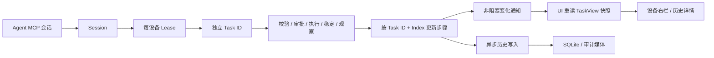

# Pinky 任务执行设计与 Farm 对照

依据本机 `/Users/liuzhuo/code/pinky` 的真实源码。范围为任务生命周期、步骤、进度通知、产物关联和设备页右栏；不把 UI 中预留的状态当成生产流程已实现的能力。

## 核心结论

Pinky 的任务界面建立在独立任务模型上，不是日志查看器。一个 Task 跨多次 Agent 调用，由明确的开始与结束边界管理；标题是显示信息，不是任务主键。“进度”主要是任务状态、已发生步骤和耗时，未知总步数时不显示完成百分比。

## 实际实现

| 设计点 | Pinky 实现与证据 | Farm 应借鉴什么 |
| --- | --- | --- |
| 身份与归属 | Session 对应 Agent 连接；设备 Lease 绑定 Task。创建和占用判断见 [agent.go](/Users/liuzhuo/code/pinky/internal/gateway/agent.go:539)、[任务创建](/Users/liuzhuo/code/pinky/internal/gateway/agent.go:666) | 用独立 task_id 关联操作，不能按 title 或 serial 猜测任务归属 |
| 任务与步骤 | TaskView 保存标题、设备、Agent、状态、起止时间与 Steps；StepView 保存可读说明、工具、参数、状态、耗时、前后图与目标坐标。[api.go](/Users/liuzhuo/code/pinky/internal/gateway/api.go:102) | 运行快照、步骤和产物关系需要结构化；日志保留诊断用途 |
| 执行结果 | 执行、等待稳定、再观察后记录普通动作结果；审批先建 pending 步骤，再按同一 index 更新。[pipeline.go](/Users/liuzhuo/code/pinky/internal/gateway/pipeline.go:1758)、[record.go](/Users/liuzhuo/code/pinky/internal/gateway/record.go:152) | 分清请求已执行与业务结果已验证；审批或重试不能重复计算步骤 |
| 通知机制 | 事件只传设备/任务 ID，UI 收到后重读快照。订阅缓冲64，发送不阻塞；UI合并约一帧内通知。[gateway.go](/Users/liuzhuo/code/pinky/internal/gateway/gateway.go:823)、[run.go](/Users/liuzhuo/code/pinky/ui/run.go:498) | 有界通知、慢UI不阻塞执行；切设备和旧请求结果必须隔离 |
| 默认右栏 | 手机页固定右侧任务区；当前设备展开，其他设备折叠，优先活动任务。[rightpanel.go](/Users/liuzhuo/code/pinky/ui/rightpanel.go:42)、[phone.go](/Users/liuzhuo/code/pinky/ui/phone.go:63) | 设备详情默认展示当前任务，不需要先去打开日志页 |
| 步骤展示 | 默认最近8步，技术工具名/参数在开发者详情中展开。[rightpanel.go](/Users/liuzhuo/code/pinky/ui/rightpanel.go:390)、[技术详情](/Users/liuzhuo/code/pinky/ui/rightpanel.go:517) | 默认简洁时间线；每步可展开原始指令、结果、错误和耗时 |
| 截图与录像 | Step 的 Before/After 媒体ID关联截图；任务录像用 TaskID 关联并提供步骤时间标记。[rightpanel.go](/Users/liuzhuo/code/pinky/ui/rightpanel.go:458)、[recordings.go](/Users/liuzhuo/code/pinky/internal/history/recordings.go:13)、[recording.go](/Users/liuzhuo/code/pinky/ui/recording.go:590) | 产物关联任务和步骤；图片、录像就近查看，不从任意结果文本猜文件名 |
| 文件存放 | Pinky 的审计媒体/录像和显式保存文件是不同路径与模型；其显式保存文件在电脑设备文件夹。[save.go](/Users/liuzhuo/code/pinky/internal/gateway/save.go:23) | Farm 已确认产物保留 Android，不照搬 Pinky 的电脑文件位置 |
| 结束与清理 | Lease结束统一取消调用、撤审批、关录像并更新状态；内存最近50个结束任务，每任务最多500步。[record.go](/Users/liuzhuo/code/pinky/internal/gateway/record.go:287)、[state.go](/Users/liuzhuo/code/pinky/internal/gateway/state.go:287) | 生命周期、任务记录清理和设备文件删除要分开；仅清理明确归属的对象 |
| 持久化 | 异步写历史，每次有超时，但队列是无界slice。[gateway.go](/Users/liuzhuo/code/pinky/internal/gateway/gateway.go:899) | 不照搬无界队列；采用有界队列或按task_id合并快照，写失败和退出收尾可观测 |

## Farm 改造前基础

- `/player?serial=...` 是完整设备详情，`embedded=1` 复用同一 DevicePlayer 作为投屏小窗。[PlayerView.vue](/Users/liuzhuo/～/code/Farm/frontend/src/views/PlayerView.vue:60)
- 右侧工具面板由互斥 Boolean 控制，可在工具未打开时默认显示任务区；需要调整 SplitLayout 的初始宽度策略。[DevicePlayer.vue](/Users/liuzhuo/～/code/Farm/frontend/src/components/player/DevicePlayer.vue:169)、[SplitLayout.vue](/Users/liuzhuo/～/code/Farm/frontend/src/components/layout/SplitLayout.vue:58)
- 现有 safety.HistoryStore 已有 tasks/steps/task_approvals，但主要由 MCP 写入；act 只有标题与环形调用日志，没有跨请求任务身份。[history.go](/Users/liuzhuo/～/code/Farm/internal/safety/history.go:23)
- 旧 task_runs/task_run_logs 已被迁移删除，不恢复旧表。[db.go](/Users/liuzhuo/～/code/Farm/internal/db/db.go:86)
- RecordStep 当前每次 upsert 都递增 step_count；如用于同一步开始/结束更新，须修正为不重复计数。[history.go](/Users/liuzhuo/～/code/Farm/internal/safety/history.go:164)
- 本次设备产物接口已支持 serial + 相对目录；产物应以 `{serial, relative_path, kind, size}` 结构化关联 task_id/step_index，下载时读取原设备。

## 已确认并实施的边界

优先选择 Pinky 的完整任务生命周期：开始一次任务取得 task_id，多次 act 与该任务关联，期间用 observe 验证页面，最后显式结束并提供结果摘要。保留现有单次 act 的调用方式时，应明确显示为独立执行批次；不能因标题相同就自动合并。用户已确认采用跨多次 act 的完整任务，需明确开始与结束；本次实现已具备该生命周期。

设备详情右侧初始宽360px、允许拖动；窄屏置于手机画面下方。卡片顺序为：任务标题与状态 → 当前步骤/耗时 → 最近步骤时间线 → 可展开指令与结果 → 图片/录像/文件入口 → 最近任务。未知总步数用“已执行N步/等待下一步”，已知单批次才用真实x/y。完整详情默认展开；投屏小窗保持紧凑默认，可从工具栏打开任务情况。

任务运行态是唯一状态源；前端订阅变化后重新读快照，或使用可取消的有界轮询。切换serial、任务结束、请求超时和设备断线都要明确处理，避免旧结果覆盖新设备。任务结束不等于删除设备产物，设备文件删除仍由明确的rm指令或后续清理操作触发。

后端任务运行态、统一任务查询和默认右侧任务面板均已实现；真实设备联调及本机1989部署已完成，见[验收记录](../verification/2026-11-13-pinky-task-panel.md)。

## 已实现的接口

- POST /api/automation/tasks?serial=...&title=...：开始完整任务并在JSON task.id返回后续使用的task_id，task.directory是建议的设备相对工作目录（需mkdir创建）。
- POST /api/automation/act?serial=...&title=...&task_id=...：向该任务追加一次有界批次，title保留必填。
- POST /api/automation/tasks/{task_id}/finish?serial=...：显式提交done/failed/stopped及summary。停止时取消正在执行的批次并收尾。
- GET /api/automation/tasks?serial=...、GET /api/automation/tasks/{task_id}?serial=...：为详情面板返回统一结构化任务快照。现有MCP审计任务通过明确映射读取，不修改既有MCP执行机制。
- 不带task_id的原act调用保留为独立批次记录；设备已有显式任务占用时拒绝无归属操作。相同标题不自动合并。

运行态内存为主，非关键持久化用单个合并写worker与原子JSON快照，不恢复旧task_runs表；设置任务数量、步骤数量及总元数据预算，超限在触设备前拒绝，不能丢弃活跃任务。新的task_id及metadata持久化只保存描述与设备产物引用，产物文件仍留在手机。
