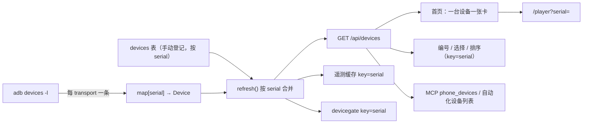
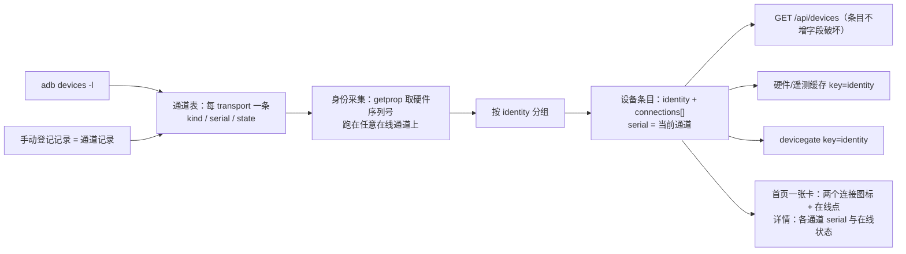
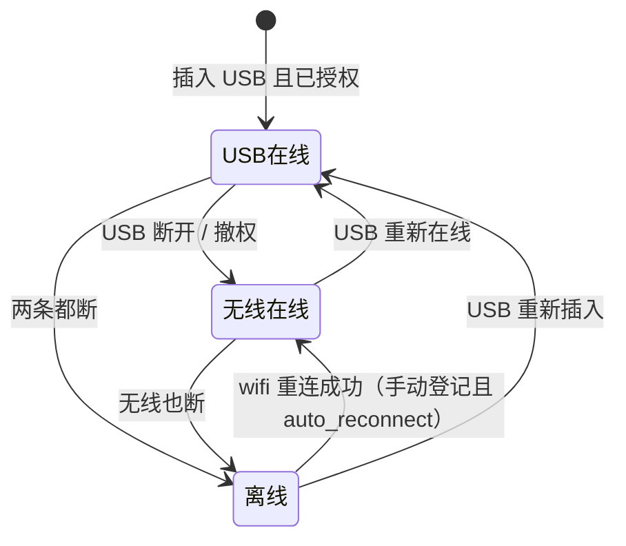

# 双连接设备归并为一个设备条目（设计）

日期：2026-11-19 · 版本：[v2026.11.19-feature](../../versions/v2026.11.19-feature/version.md) · 状态：方向已定（方案一），拍板已完成，实施见 [tasks.md](../../versions/v2026.11.19-feature/tasks.md) · 原型：[方案一（定稿）](../../prototypes/cases/dual-link-device-v1/Prototype.vue)、[方案二（仅留档）](../../prototypes/cases/dual-link-device-v2/Prototype.vue)

同一台手机同时插 USB、又开了无线调试时，`adb devices` 会出现两条记录（USB 用硬件序列号，无线用 `IP:端口`），Farm 现在按 serial 直接展示，于是同一台机器变成两个条目：列表翻倍、编号/选择/投屏窗口各算一台、手动登记与别名各挂一份。本设计把两者归并成一个设备条目，并在条目上表达“有几种连接方式、各自是否在线、当前走哪条”。

已确认的显示口径（用户 2026-11-19 定）：连接方式只显示图标，不显示“USB / 无线”文字；不提供手动切换通道；默认走 USB。本设计按此收敛，不再保留切换类交互。

## 现状



问题根因：设备的唯一键被当成“连接的唯一键”。一条连接一个 serial，一台设备却可能有两条连接。

## 归并后



## 1. 归并键：设备自身身份

只在“通道在线且已授权”（`adb devices` 状态为 `device`）时采集，命令都跑在该通道的 serial 上：

| 顺序 | 来源 | 命令 | 说明 |
| --- | --- | --- | --- |
| 1 | 硬件序列号 | `adb -s <serial> shell getprop ro.serialno` | 与 USB serial 通常一致，跨重启不变；部分 ROM 为空或 `unknown` |
| 2 | 启动序列号 | `adb -s <serial> shell getprop ro.boot.serialno` | 1 取不到时兜底，同样跨重启不变 |
| 3 | Android ID | `adb -s <serial> shell settings get secure android_id` | 恢复出厂设置后会变；同一台机、同一用户下稳定 |

规则：

- 身份字符串统一加命名空间前缀：`hw:<值>` / `aid:<值>`，避免两套来源撞值。
- 校验后才采用：去空白；非空；不等于 `unknown` / `null` / `0` / `0123456789ABCDEF` / 全零；长度 4–64。不满足即视为“本次取不到”，继续下一个来源。
- 三个来源都取不到（新插入未授权、连接瞬间、离线残留）：**该通道不参与归并**，作为独立条目出现，身份状态标记 `pending`；下一次刷新采到身份再合并。绝不用型号、品牌、IP 段、别名或字符串相似度猜配。
- 通道的 `IP:端口` 可能被 DHCP 复用给另一台手机：每次该通道从离线变在线、或重连成功，都重新采集一次身份；与缓存身份不一致时，把该通道记录改挂到新身份（旧设备条目下移除该通道），并打日志 `[Device] channel identity changed serial=... old=... new=...`。
- 硬件信息、遥测、别名等“设备级”数据一律按 identity 存；同一条设备的两条通道不重复采集（只走当前通道）。

## 2. 一个设备条目表达多条连接

接口在现有 `Device` 上**追加**字段，旧的 `serial` / `state` 语义不变（`serial` = 当前通道的 adb serial），因此 `/player?serial=`、`/ws?serial=`、`/api/devices/{serial}`、桌面原生菜单、手机端都不需要改就能继续工作。

```json
{
  "serial": "31040209940025Z",
  "state": "device",
  "identity": "hw:31040209940025Z",
  "identity_source": "ro.serialno",
  "active_kind": "usb",
  "connections": [
    { "kind": "usb",  "serial": "31040209940025Z",   "address": "",                 "state": "device",  "online": true,  "active": true,  "last_seen_at": 1763550000000 },
    { "kind": "wifi", "serial": "10.0.0.104:5555",   "address": "10.0.0.104:5555",  "state": "device",  "online": true,  "active": false, "last_seen_at": 1763550000000 }
  ]
}
```

- `connections` 至少 1 条，最多 2 种 `kind`（`usb` / `wifi`）。同 kind 出现多条（例如 `adb connect IP:端口` 与 mDNS 的 `adb-<序列号>-<后缀>` 同时存在）时，取 `last_seen_at` 最新的一条作为该 kind 的代表，其余只保留在通道表里，不进接口。
- 设备级 `state` 由通道推导：任一通道 `device` → `device`；都在 `connecting` → `connecting`；任一 `unauthorized` → `unauthorized`；否则 `offline`。
- `identity` 未取到时，`identity` 为空、`identity_source` 为 `pending`，`connections` 只有一条。

存储（新增，不动老表结构语义）：

```sql
-- 通道：一条 adb 连接一行；老 devices 表的 manual 记录继续作为 wifi 通道使用
CREATE TABLE device_channels (
  serial TEXT PRIMARY KEY,          -- adb serial（USB 硬件序列号 或 IP:端口）
  identity TEXT NOT NULL DEFAULT '',-- hw:... / aid:...；空表示未采集
  kind TEXT NOT NULL,               -- usb | wifi
  address TEXT NOT NULL DEFAULT '',
  state TEXT NOT NULL DEFAULT 'offline',
  auto_reconnect INTEGER NOT NULL DEFAULT 0,
  last_seen_at INTEGER NOT NULL DEFAULT 0,
  updated_at INTEGER NOT NULL
);
-- 设备级：别名挂身份，不再挂通道
CREATE TABLE device_identities (
  identity TEXT PRIMARY KEY,
  alias TEXT NOT NULL DEFAULT '',
  created_at INTEGER NOT NULL,
  updated_at INTEGER NOT NULL
);
```

迁移：启动时把 `devices` 里 `source='manual'` 的行导入 `device_channels`（`kind=wifi`，保留 `auto_reconnect`），其 `alias` 迁到首次采到身份的 `device_identities`；未采到身份的旧 alias 暂留在 `devices`，采到后迁移。迁移只做一次，`PRAGMA user_version` 递增。

## 3. 通道选择（自动，USB 优先）

| 条件 | 当前通道 |
| --- | --- |
| USB 在线 | `usb` |
| USB 不在线、无线在线 | `wifi` |
| 都离线 | 无（条目仍保留，`state=offline`） |

不提供手动切换。切换只发生在通道上下线时，且是“下一次操作走新通道”，不做会话中途迁移：



正在进行的会话（投屏流、ADB 终端、文件传输、自动化任务）绑定在发起时的通道 serial 上：

- 通道消失时该会话按现有逻辑失败结束（投屏断流、终端断开、传输报错），不自动改写到另一条通道：scrcpy 会话、PTY、`adb push` 都无法无损迁移。
- 前端的“重新连接”走一次解析：`GET /api/devices/{任意通道 serial 或 identity}` 返回当前通道 serial，再用它重连。已在通道上的客户端仍可直接用原 serial 访问同一台设备。
- 自动化任务（`/api/automation/act?serial=`）每次请求按 serial 解析到当前通道，所以任务中途换通道不影响后续请求；任务历史记录“实际使用的通道 serial”，同时记 identity 便于按设备汇总。

## 4. 显示约定（已定稿：方案一 并列图标）

2026-11-19 用户选定方案一。两个方向都留在 `prototypes/cases/`，均为本地 mock，不连真实接口；方案二只作对照留档，实现按方案一。

| 方向 | 首页卡片 | 详情页 | 预览 |
| --- | --- | --- | --- |
| **方案一 并列图标（定稿）** | 两个等权图标块并列，当前通道为彩色填充，另一通道描边，右上角小圆点表示在线；离线的图标压暗并加斜线 | 「连接方式」列表：每行 图标 + 该通道 serial/地址 + 在线/已断开 + “当前”标记 | `#dual-link-device-v1` |
| 方案二 主次图标（留档） | 当前通道彩色图标块 + 另一通道一个无框小图标（带在线点），信息更紧 | 「连接方式」两张并排小卡，字段同上 | `#dual-link-device-v2` |

共同约定：

- 卡片上不出现“USB / 无线”文字，只用 `Usb` / `Wifi` 图标；在线状态用图标右上角圆点（绿=在线，灰=离线），离线再叠一条斜线，不只靠颜色区分。
- 卡片底部只出现一次设备标识（`型号 · 硬件序列号`）；各通道的 `IP:端口` 只在详情页出现，避免重复信息。
- 只有一种连接方式的设备与今天完全一致，不做额外标记。
- 原型复用现有主题与 `@/components/ui`，未新增基础组件；缺口：现有组件库没有“图标状态徽标”这类原子组件，原型里用 Tailwind 拼了图标块，正式实现时若要多处复用需先补一个小组件（`DeviceLinkBadge`），否则就地内联。

截图与预览记录：`prototypes/artifacts/dual-link-device-v1|v2/`（桌面、暗色、小屏）、`prototypes/artifacts/remote-preview/2026-11-19-dual-link/`（公网验证）。

## 5. 边界与异常

| 场景 | 行为 |
| --- | --- |
| 只有 USB | 一条连接，展示同今天 |
| 只有无线 | 一条连接，展示同今天 |
| 两条都离线但残留 | 保留一个条目（`state=offline`），通道各自标离线；手动登记且 `auto_reconnect` 的 wifi 通道继续重连，重连前不重复 `adb connect`（同一设备有条通道在线时不重连） |
| 同型号两台不同手机 | `ro.serialno` 不同 → 两个条目；测试用两台同型号机具验证 |
| 刚接入、身份未取到 | 该通道先独立成条目（`identity_source=pending`），采到身份后与已有条目合并，编号/顺序按 identity 稳定，不出现闪跳的第三张卡 |
| 恢复出厂设置 | `android_id` 变，硬件序列号不变 → 仍是一个条目（走 `hw:` 身份） |
| `ro.serialno` 为 `unknown` 的机型 | 降级到 `ro.boot.serialno`，再降级 `android_id`；来源记录在 `identity_source`，便于排查 |
| 同一身份出现两条同类通道 | 只取最新的一条作为该 kind 的代表，其余留表中，不合并成第三条 icon，日志记录重复连接 |
| 手动登记地址被别的手机占用 | 重新采集身份后改挂新身份，两台手机各自独立；不按 IP 认定“还是原来那台” |
| USB 与无线同时在线且都在跑投屏 | 当前通道只有一个（USB），另一条只是备用；不同时起两路 scrcpy |
| ADB 重启 / kill-server | 通道全部消失 → 条目变离线，重新发现后按缓存身份恢复合并，别名与顺序不变 |

## 6. 影响面

| 位置 | 现状 | 需要改什么 | 语义是否变化 |
| --- | --- | --- | --- |
| `internal/device/manager.go` | `refresh()` 按 serial 合并手动记录 | 引入通道表 + 按 identity 分组；`Device` 增加 `identity` / `connections` / `active_kind` | 否（`serial` 仍为当前通道） |
| `internal/device/telemetry.go` | 缓存 key=serial，在线设备逐条采集 | key 改 identity；每设备只采当前通道；硬件信息采一次 | 否 |
| `internal/device/discovery.go` | 扫码/扫描成功后 `UpsertManualDevice(address)` | 写入通道记录，触发一次身份采集 | 否 |
| `internal/db` | `devices` 表按 serial | 新增 `device_channels` / `device_identities`；alias 读写改按 identity | 否（老表保留兼容期） |
| `internal/devicegate` | 每 serial 一把门 | 改为每 identity 一把门 | 否（并发度更严，避免两条通道同时操作同一台机） |
| `internal/ws/hub.go`、`internal/scrcpy` | 会话按 serial 起 | 起会话前把入参解析成当前通道 serial；`/ws?serial=` 仍接受任意通道 serial | 否 |
| `internal/idlescreen` | 空闲计时按 serial | 改为按 identity（两条通道算一台） | 否 |
| `internal/safety/history`、`internal/operationlog` | 记录 `serial` | 追加 `identity` 列；`serial` 记实际通道 | 是（新增列，查询兼容） |
| `internal/automation` | `/api/automation/devices` 一行一 serial；`act` 按 serial 解析 | 设备列表改为一行一设备（双连接只一行），解析接受任意通道 serial 或 identity | **是**，需拍板（下文 A） |
| `internal/mcp/server.go` | `phone_devices` 列 serial，`resolveDevice` 按 serial/标识名 | 同上：列表按设备，解析先映射到 identity 再取当前通道 | **是**，需拍板（A） |
| `frontend/src/stores/devices.ts` | key=serial；排序/隐藏/选择存 localStorage | key 改 identity；本地偏好做一次迁移（老 serial → 新 identity，找不到就丢弃该项） | 否 |
| `frontend/src/components/device/DeviceCard.vue` | 一个连接徽标（USB/无线） | 按原型改为图标组 | 是（展示） |
| 详情页连接面板 | 无 | 新增「连接方式」区（只读） | 是（新增） |
| `desktop/src/menu_devices.rs`、`mobile/` | 读 `/api/devices` 的 `serial` | 不用改（自动变成每设备一条） | 否 |
| `docs/glossary.md`、`api/openapi.json`、`/fram.skill` | 按 serial 描述设备 | 新增「设备身份」「连接方式」术语；接口字段与设备列表口径同步 | 是（文档） |

## 7. 拍板结果

2026-11-19 用户「按这个改」，按建议执行：

| # | 事项 | 结论 |
| --- | --- | --- |
| A | `/api/automation/devices` 与 MCP `phone_devices` 从“一行一 serial”改成“一行一设备” | **改**。S6 同步更新 `/fram.skill` 契约文本与设备发现说明 |
| B | 任务历史 / 操作日志是否回填历史 identity | 只加列不回填；历史双条目保持原样，不做猜测性合并 |
| C | 数据库新增两张表还是给 `devices` 加列 | 新增 `device_channels` / `device_identities`；老表继续承担手动登记，迁移可回滚 |
| D | 同一身份的两条同类通道是否在详情页列出 | **不列**，只取 `last_seen_at` 最新一条 |

## 8. 分步实施（每步可单独验收）

| 步骤 | 内容 | 单独验收 |
| --- | --- | --- |
| S1 | 通道身份采集与缓存、`Device` 追加 `identity` / `connections` / `active_kind` 字段（仍按 serial 出条目，不做分组） | `GET /api/devices` 能看到 `identity`；同一台机两条记录的身份相同、`identity_source=ro.serialno`；打断言可离线单测（mock adb 输出） |
| S2 | 后端按 identity 分组，`serial`=`当前通道`；别名/遥测/硬件缓存/门控改按 identity | 插 USB + 开无线，`GET /api/devices` 只剩一条，`connections` 两条；断开 USB 后 `serial` 与 `state` 自动切到 wifi；别名在切换后不变 |
| S3 | 前端按 identity 做 key、排序/隐藏/选择迁移；卡片按方案一改并列图标（当前通道彩色填充、另一路描边、离线压暗加斜线） | 首页一张卡两个图标；编号/拖动顺序在切通道后不变；本地老偏好迁移不丢设备 |
| S4 | 详情页「连接方式」只读面板；`/api/devices/{serial}` 支持任意通道 serial 解析 | 用无线 serial 打开 `/player` 能进同一台设备；详情页显示两条通道的 serial 与在线状态 |
| S5 | 数据库迁移 + 手动登记并入通道表 + 自动重连按设备去重 | 重启后别名/登记记录/顺序保留；离线设备不重复 `adb connect` |
| S6 | 自动化/MCP 设备口径与文档（依赖拍板 A） | `/api/automation/devices` 双连接只一行；MCP 用任一通道 serial 都能解析到同一台 |

建议 S1→S2 一次提交（后端可独立验收），S3→S4 一次提交（界面可独立验收），S5、S6 分开。

分工：开发由农场开发员执行 S1–S6；每个 S 完成后交农场测试员按第 9 节用例验收，未过退回。S6 依赖第 7 节拍板 A。

## 9. 验收用例（测试员可直接照写）

| 用例 | 步骤 | 期望 |
| --- | --- | --- |
| T1 双连接合并 | 手机插 USB、开无线调试并 `adb connect`，打开首页 | 只出现 1 张卡；卡上有 USB 与无线两个图标，均带绿色在线点；详情页两条连接、USB 标“当前” |
| T2 默认 USB | 保持 T1，连续刷新 30 秒并下发一次点击 | 始终走 USB（`GET /api/devices` 的 `serial` 为硬件序列号，`active_kind=usb`）；不会两条通道各起一路投屏 |
| T3 USB 拔掉 | T1 状态拔掉 USB | 卡片仍在、变无线为当前；无线图标为彩色、USB 图标压暗加斜线；投屏若在播则断流，重连后走无线 |
| T4 无线关掉 | 只留 USB，关闭手机无线调试并 `adb disconnect` | 卡片仍在、USB 为当前；无线图标离线；不出现第二张卡 |
| T5 全离线 | 拔 USB 并断无线 | 一个离线条目；手动登记且开启自动重连时，恢复网络后自动回到在线且仍是一个条目 |
| T6 身份未取到 | 新机插 USB 但手机上不点“允许调试” | 先出现一个待授权条目（单独一条），点允许后与既有条目合并，过程中不出现长期并存的两条 |
| T7 同型号两台 | 两台同型号手机同时接入（一台 USB、一台无线） | 两个条目，各自图标正确；任意操作不会串到另一台 |
| T8 IP 被复用 | 断开 A 机无线，把同一 `IP:端口` 连到 B 机 | 通道归到 B 机；A 机条目不再显示该地址；日志有 `channel identity changed` |
| T9 恢复出厂 | 一台已合并设备恢复出厂并重新授权 | 仍是同一个条目（`identity_source=ro.serialno`）；若原身份来自 `android_id`，则出现新条目，旧条目保留为历史离线记录 |
| T10 别名与顺序 | T1 上改标识名、拖动顺序，再切到无线 | 标识名与顺序不变；详情页两条连接地址正确 |
| T11 会话与解析 | 用无线 serial 打开 `/player?serial=10.0.0.104:5555` | 进入同一台设备详情；断开无线后该页失败，重新连接走 USB |
| T12 自动化口径 | 双连接在线时请求 `/api/automation/devices` | 只列一台；`act` 用任一通道 serial 都能执行到同一台 |

## 10. 风险

- **身份采不到的窗口期**：未授权、连接瞬间会短暂出现两个条目，用户可能误以为没合并。S2 用 `identity_source=pending` 明确状态，并在下一次刷新（2 秒）内完成合并。
- **身份不可靠的机型**：少数定制 ROM 返回 `unknown` 或复用同一串号，会误合并。校验拒绝 `unknown`/全零；同 kind 重复连接不做合并；上线前用抽到的机型清单跑一遍身份采集（含红米、OPPO、华为各一台）。
- **`serial` 会变化**：当前通道切换后，后端列表里的 `serial` 从硬件序列号变为 `IP:端口`。依赖“serial 恒定”的前端本地状态（顺序、隐藏、选择）若不改 key 会丢，因此 S3 必须和 S2 一起验收。
- **并发门控变严**：门控从 per-serial 改为 per-identity 后，两条通道不再并行操作同一台机，极端情况下吞吐下降，但避免触控错乱，属于预期。
- **对外口径变化**（拍板 A）：自动化设备列表与 MCP 列表条数减少，依赖“条数”或“第一条即某台设备”的技能可能改走另一台。需要连同 `/fram.skill` 一起改，并在变更说明里写明。
- **数据库迁移**：迁移脚本要可重复执行且失败可回滚；`devices` 老表在 S5 后再考虑清理，不与 S1–S4 同批删除。
