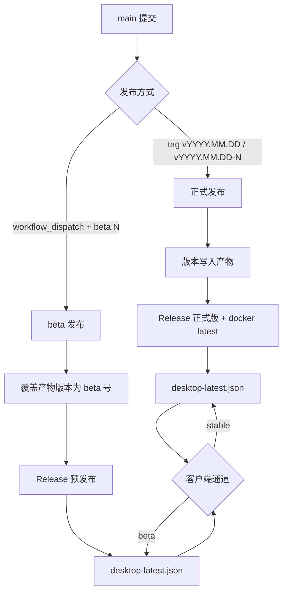
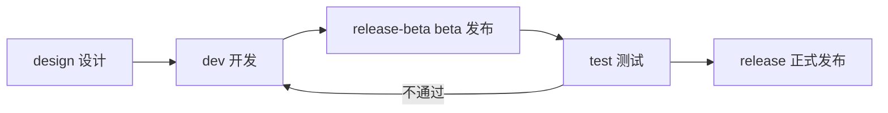

# 更新通道：正式版 / beta（含 CLI、桌面与服务器二进制）

日期：2026-11-20
状态：设计待确认

## 1. 背景与目标

当前只有一条发布线：main 打 `v*` tag → GitHub Release（正式）→ 桌面端与独立 Go 程序从 `releases/latest` 更新；服务器二进制由 `scripts/deploy/deploy-prod.sh` 覆盖 `/opt/farm`。

日常开发测试缺一条可自更新、可部署的通道，于是每次测试都等于动正式版的号码和产物。目标：

- 像常见软件那样在设置里选择更新通道（默认正式版，可选 beta）。
- beta 覆盖全部发布形态：桌面 App（Windows NSIS / macOS DMG + 更新包 / AppImage）、五平台 CLI、Windows GUI exe、服务器 linux-amd64 二进制。
- 正式用户零影响：未切换通道的客户端永远看不到 beta。
- PyPI 的 `farm-sdk` 改为「SDK 真有改动才发新版本」。

不在本版范围：灰度百分比、多渠道（alpha/nightly）、按设备分组的通道策略。

## 2. 现状与硬约束

| # | 事实 | 位置 | 后果 |
| --- | --- | --- | --- |
| 1 | 桌面更新地址硬编码 `releases/latest/download/desktop-latest.json` | `desktop/src/updater.rs:57` | 必须改为运行时按通道构造 |
| 2 | Go 自更新只请求 `/releases/latest` | `internal/updater/checker.go:92` | 只认正式版，需按通道取列表 |
| 3 | 版本比较丢弃预发布后缀 | `internal/updater/checker.go:206` | 见第 3.3，现有 `-N` 号之间的自更新本就失效 |
| 4 | 无通道概念 | — | Go 侧无通道配置，桌面侧无法感知 |
| 5 | GitHub `/releases/latest` 排除 prerelease | GitHub 语义 | beta 标 prerelease 后正式通道天然隔离 |
| 6 | 发布校验 `VERSION == tag` | `.github/workflows/release.yml:59` | beta tag 不能等于 VERSION，需扩展校验 |
| 7 | `merge-desktop-manifests.mjs` 要求产物版本 == `VERSION` | `scripts/merge-desktop-manifests.mjs:6` | beta 需在构建期覆盖版本文件 |
| 8 | Docker job 固定推 `farm:latest` | `.github/workflows/release.yml:267` | beta 若跑全流程会覆盖正式镜像，必须排除 |
| 9 | PyPI 版本由根 `VERSION` 驱动 | `scripts/sync-version.mjs`、`.github/workflows/python-sdk.yml` | 每次应用发版都会发一个 SDK 版本 |
| 10 | SDK 版本同时是运行时依赖要求 | `internal/servicepython/manager.go:48`、`internal/dependencies/python.go:108` | 解耦后每次应用升级不再强制重装 matching 环境 |

## 3. 方案

### 3.1 通道模型

两个通道，取值 `stable`（默认）/ `beta`。通道是客户端本地设置，存后端配置（Web 与桌面共用一份），不是服务端策略。

| 端 | stable 数据源 | beta 数据源 |
| --- | --- | --- |
| 桌面 App（Tauri） | `releases/latest/download/desktop-latest.json` | 后端解析最新 prerelease tag → `releases/download/<tag>/desktop-latest.json` |
| 独立 Go 程序 | `GET /releases/latest` | `GET /releases?per_page=20`，过滤 `prerelease && !draft && tag 形如 v*-beta.*`，取最高版本 |
| 服务器（systemd） | `deploy-prod.sh` | `deploy-beta.sh` → 独立实例（第 3.5） |
| Docker | `farm:latest` | 不参与 beta |

桌面端 beta 包必须沿用现有更新私钥（`TAURI_SIGNING_PRIVATE_KEY` / `desktop/updater.pub`），否则已装正式版的用户切到 beta 后无法验签安装。

桌面端 endpoint 由后端统一解析，Rust 不重复实现 GitHub 解析：`GET /api/version/desktop-endpoint` 返回 `{channel, endpoint}`；请求失败或后端未就绪时回退 stable 并写日志。

### 3.2 发布流

beta 走现有 `release.yml`，按 tag 名分支，差异只有四处：

| 项 | 正式 | beta |
| --- | --- | --- |
| 版本校验 | `VERSION == tag` | `tag == v$(VERSION)-beta.N`，或 workflow_dispatch 输入 beta 号 |
| 产物版本 | 用 `VERSION` | 构建前执行 `node scripts/sync-version.mjs --version <beta号>`（含写 `VERSION`），不提交 |
| Release 标志 | 默认 | 显式 `prerelease: true` |
| Docker job | 推 `latest` 与 `farm:<tag>` | 跳过 |
| Release 说明 | `docs/versions/<tag>-*/version.md` | 无对应目录时按提交记录自动生成（现有 fallback） |

`sync-version.mjs` 新增 `--version <值>`：校验 SemVer 后覆盖 `VERSION` 与全部产物版本文件，不写 git。

### 3.3 版本号与比较规则

现行编号是「日期 + 同日序号」：`v2026.11.11`、`v2026.11.11-1`、`v2026.11.17-1`。它在标准 semver 里 `-1` 表示预发布（低于 `v2026.11.11`），与实际发布顺序相反；而 Go 现有比较器丢掉后缀，导致 `v2026.11.17-1 → v2026.11.17-2` 永远判定为「无更新」。这是现存缺陷，必须随本版修掉。

保留现有编号习惯，改为自定义优先级（`internal/updater`）：

1. 主段（`YYYY.MM.DD`）逐段数值比较，大者更新。
2. 主段相同时按后缀分级：`beta.K` < 无后缀 < 数字补丁 `N`；同级按 K/N 数值比较。
3. 也就是：`v2026.11.20-beta.2` < `v2026.11.20` < `v2026.11.20-1` < `v2026.11.20-2` < `v2026.11.21`，与历史发布顺序一致。

配套约定（写入 `docs/workflows/release.md`）：

- 同一日期一旦发过 `-N`，不再发布该日期无后缀的正式版。
- beta 号的日期段必须严格大于当前最新正式号的日期段，例如正式 `v2026.11.20` 之后 beta 为 `v2026.11.21-beta.1`、`-beta.2`；不出现同号 beta 与 `-N` 混用。

### 已定：桌面端 semver 与 `-N` 的冲突

Tauri 更新器用标准 semver 比较版本，`2026.11.17-1` 会被当作预发布，判定低于 `2026.11.17`。因此桌面端升级 **`正式号 → 同日 -N` 不会提示更新**，与本项目「同日 `-N` 是补丁」的实际顺序相反；Go 侧自定义比较器按真实顺序处理。

采用 **方案 A**：

- 桌面端只发布三段日期号（`vYYYY.MM.DD`）；同一天需要再发一个桌面版本时，直接把日期段进位到下一个可用日期，不用 `-N`。
- `-N` 只用于 CLI、服务器二进制等不看 semver 的产物。
- beta 与正式都用三段日期号，beta 为 `vYYYY.MM.DD-beta.N`，桌面端 semver 能正确判定 beta < 正式。

## 3.4 客户端交互

系统配置 → 通用设置 → 更新区域新增「更新通道」，两项：正式版 / beta 测试版，沿用现有 `divide-y rounded-lg border` 卡片与开关样式，不新增解释文案。切换通道后清空上次检查结果并立即重新检查一次；若 beta 检查无更新，保留通道不动。

`checkOnStartup` / `autoUpdate` 行为不变：自动更新只对当前通道生效；beta 自动更新同样受 `can_upgrade` 约束（systemd、Docker、便携目录仍只提示不替换）。

## 3.5 服务器 beta 实例

生产 `10.0.0.6` 保持 `farm.service` 不动，新增并存的 beta 实例：

| 项 | 生产 | beta |
| --- | --- | --- |
| systemd | `farm.service` | `farm-beta.service` |
| 端口 | 8080 | 8081 |
| 路径 | `/opt/farm` | `/opt/farm-beta` |
| 数据 | `/opt/farm/data/farm.db` | `/opt/farm-beta/data/farm.db` |
| 部署脚本 | `scripts/deploy/deploy-prod.sh` | `scripts/deploy/deploy-beta.sh`（端口参数化，不再写死 8080 健康检查与「生产环境」提示） |

同机并存的风险：两个实例共用本机 adb server（5037）与同一批设备，可能争抢同一台设备的投屏编码器。因此 beta 实例若接入设备，必须先验证「同一台手机同时被两个实例投屏/操作不互抢」，否则 beta 只用于界面与接口验证。该验证写入验收项，未通过则 beta 实例保持不接生产设备。

## 3.6 SDK 独立版本与按需发布

当前 SDK 版本由根 `VERSION` 派生，导致每次应用发版都往 PyPI 发一个内容相同的 `farm-sdk`（`2026.11.17-1` 在 PyPI 上被规范化为 `2026.11.17.post1`，版本不可撤回）。

改为独立版本：

- 新增 `packages/python-sdk/VERSION`，SDK 独立编号，从 `2026.11.18` 起用纯日期号（必须大于已发布的 `2026.11.17.post1`）。
- 新增 `scripts/sdk-version.mjs`：把 SDK 版本写入 `pyproject.toml`、`version.go`、`src/farm/__init__.py`，支持 `--check`；`sync-version.mjs` 移除这三项。
- `python-sdk.yml` 触发路径改为 `packages/python-sdk/**`、`scripts/sdk-version.mjs`、自身；tag 触发时不再要求 tag 等于 SDK 版本，改为校验三处 SDK 版本一致。
- 防止「改了 SDK 忘改版本」：CI 检查本次提交若修改了 `packages/python-sdk/src/**` 或 `pyproject.toml` 却未修改 `packages/python-sdk/VERSION`，直接失败。
- 效果：SDK 无改动的应用发版不再产生 PyPI 记录；`pythonsdk.Version` 不变，matching 环境不再因应用升级而强制重装。

## 3.7 工作流顺序

发布通道上线后，`docs/workflows/` 的流程顺序改为：

| 文档 | 变化 |
| --- | --- |
| `docs/workflows/release-beta.md` | 新增：从 main 打 beta tag、核验预发布产物、部署 8081 beta 实例、交接测试 |
| `docs/workflows/test.md` | 改为在 beta 发布之后执行，测试对象是 beta 包与 8081 实例；不通过则重发 beta.N+1 |
| `docs/workflows/release.md` | 收敛为正式发布：以测试通过为前提，只做正式 tag、Release、生产部署与更新核验 |

## 4. 影响面

| 模块 | 改动 |
| --- | --- |
| `internal/updater/checker.go` | 通道参数、beta 列表解析、自定义版本比较 |
| `internal/updater/handlers.go` | `check?channel=`、通道读写、`desktop-endpoint` |
| `internal/updater/transaction.go` | 下载地址前缀校验按实际选中 tag |
| `desktop/src/updater.rs` | 通道 endpoint 由后端解析，检查与安装共用 |
| `frontend/src/composables/useUpdateSettings.ts` | 增加 `channel`，旧值默认 stable |
| `frontend/src/components/system/SystemConfigDialog.vue` | 通道选项 |
| `frontend/src/stores/updater.ts` | 切通道后重新检查 |
| `.github/workflows/release.yml` | beta 分支：版本覆盖、prerelease、跳过 docker |
| `.github/workflows/python-sdk.yml` | 触发路径与版本校验 |
| `scripts/sync-version.mjs` | `--version` 覆盖；移除 SDK |
| `scripts/sdk-version.mjs` | 新增 |
| `scripts/deploy/deploy-beta.sh` | 新增，端口参数化 |
| `docs/workflows/release-beta.md` | 新增 beta 发布流程 |
| `docs/workflows/test.md`、`docs/workflows/release.md` | 测试移到 beta 之后，正式发布收敛为晋级步骤 |
| `docs/updating.md`、`docs/environments/beta.md`、`docs/glossary.md` | 通道、beta 部署、术语登记 |

## 5. 风险

1. **beta 覆盖正式资产**：Docker `latest` 与 PyPI 是两处最容易误伤正式用户的地方，发布流水线必须硬性排除，不是靠人记得。
2. **签名一致性**：beta 若换密钥，正式版用户切通道后装不上包；本版沿用同一密钥。
3. **服务器双实例争设备**：adb server 唯一，投屏编码器可能互抢；未验证前 beta 不接生产设备。
4. **版本比较语义变更**：自定义比较器与标准 semver 在 `-N` 上不同，需单测覆盖历史 tag 顺序（`v2026.11.11 < v2026.11.11-1 < v2026.11.11-2 < v2026.11.12`）与 beta 顺序（`-beta.1 < -beta.2 < 同号正式`）。
5. **beta 自动更新回滚**：beta 装坏了要能回退到正式版，桌面与独立程序都需验证「beta → 正式版」方向可安装。
6. **SDK 版本漂移**：解耦后忘记 bump 会导致 PyPI 长时间不更新，由 CI 检查兜底。

## 6. 验收要点

- T1 正式通道：装机后检查更新只看正式 Release，beta 存在时无更新提示。
- T2 beta 通道：切到 beta 后能发现并安装 beta 包，重启后版本为 beta 号。
- T3 回退方向：beta 用户在同号正式版发布后可升级到正式版。
- T4 CLI：beta 通道下 linux/macOS/windows CLI 自更新取到 beta 资产并通过 SHA-256 校验。
- T5 服务器：`deploy-beta.sh` 部署后 8081 可访问，8080 与 `farm.service` 不受影响。
- T6 PyPI：只改应用代码的应用发版不产生新的 `farm-sdk` 版本；改 SDK 源码未 bump 时 CI 失败。
- T7 现有 `-N` 编号在自更新里能正确判定（`v2026.11.17-1 → v2026.11.17-2`）。
