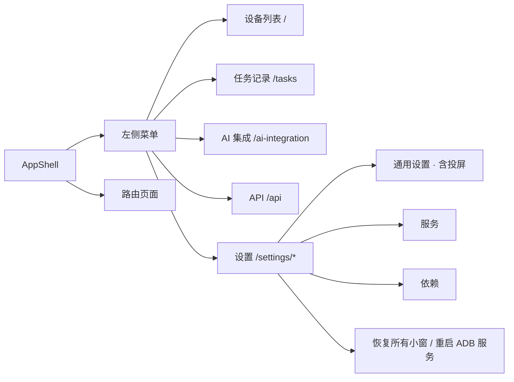

# 2026-11-21 主界面侧边菜单与设置页

## 目标

把主窗口从“顶部操作栏 + 系统设置弹窗”改成“左侧可收起菜单 + 独立设置页”，并补齐全设备任务记录入口。

## 结构

## 已确认的决定

| 项 | 结论 |
| --- | --- |
| 菜单形态 | 左侧固定菜单，可展开/收起，宽度状态本地持久化 |
| 设置入口 | 底部设置展开后列出通用、服务、依赖；点击进入独立路由页，不再弹窗 |
| 投屏设置 | 合并进“通用设置”页 |
| 任务记录 | 新增全设备任务记录页，后端提供只读汇总接口，详情按任务懒加载 |
| API 入口 | 新增应用内 API 页，汇总自动化接口、全量接口与常用调用地址 |
| 快捷操作 | 设置展开区放入“恢复所有小窗”和“重启 ADB 服务”；恢复小窗仅桌面端可用 |
| 依赖保存 | 移除保存按钮，修改后防抖自动保存并立即生效；首次进入使用骨架屏 |

## 范围

- 前端：`AppShell`、侧边菜单、任务记录页、API 页、三个设置页、路由登记、相关页面移除顶部栏与设置弹窗。
- 后端：新增 `GET /api/automation/task-records` 全设备只读任务汇总；原单设备任务接口保持不变。
- 桌面端：新增“恢复所有小窗”命令；重启 ADB 复用现有 `POST /api/adb/restart`。
- 文档：更新 `docs/glossary.md` 页面与面板指向。
- 发布：补齐 beta 发布流水线，允许 `v*-beta.N` 预发布且不影响正式通道。

不包含：多设备任务分组、任务删除、设置页权限体系、移动端专用布局。

## 验收

1. 主页面无顶部操作栏，左侧菜单可展开/收起，四个主导航与底部设置可用。
2. 设置不再弹窗；通用、服务、依赖均为独立页面，刷新后仍停留在原页面。
3. 任务记录能看到所有设备任务，按状态筛选，打开详情能看到步骤与产物。
4. 依赖页首次进入显示骨架屏；修改来源或路径后无需点保存，自动生效。
5. 桌面端“恢复所有小窗”可用；“重启 ADB 服务”请求真实接口。
6. `pnpm --dir frontend build`、`go test ./...`、相关 Rust 测试通过。
7. Mac mini（10.0.0.11）实机浏览器完成上述界面验证。
