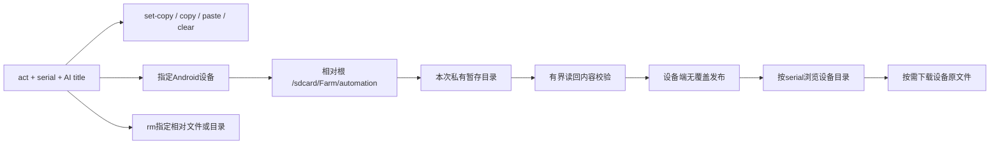

# 自动化设备产物与剪贴板验证（2026-11-13）

## 最终范围

实际源码：`/Users/liuzhuo/～/code/Farm`，分支 `lz/v2026.11.13-feature`。没有修改 `/Users/liuzhuo/code/Farm` 中不包含当前契约的旧代码，也未清理其他已有改动。

- 最后帧三个现有等价路径增加 POST，与 GET 返回同样的 JPEG/PNG 图片流。
- act 必填 serial/title，title由AI为完整任务生成；JSON日志顶层title、文本title字段贯穿观察、ADB、产物及失败清理。
- 新增 adb、set-copy、copy、paste、clear、mkdir、screenshot、record、rm；移除 act ocr。check/wait复用默认observe的本轮可见文字，不影响其diff缓存。
- **产物保留在Android设备** `/sdcard/Farm/automation` 下。mkdir/screenshot/record/rm只接收根内相对路径。截图和录屏只在电脑内存有界读回校验，不自动保存成电脑产物；成功设备文件保留。
- PNG 20MiB、MP4 32MiB，record 1..30秒无音频。校验有效内容及正时长后在设备端无覆盖发布；失败/取消只清理本次暂存和可证明归属的最终文件，碰撞不删除旧文件。
- 目录浏览/下载必填serial和相对directory，每条URL带同一serial。列表NUL分隔读取，最多1000文件；独立容量4、读取30秒，单文件下载32MiB。使用ADB shell -T保持二进制字节、远端退出码和stderr分离。
- clear只清当前聚焦可编辑输入框且不改剪贴板；rm只删除指定设备根内的明确文件/目录，拒根目录、绝对路径、..及符号链接。

## 验证结果

- Go全量测试；automation/debug竞态检查。设备产物、协议与标题相关测试覆盖损坏内容、零时长、超限、取消、路径越界、symlink、普通文件检查、发布碰撞和任务标题隔离。
- vivo `10.0.0.104:5555`：mkdir、PNG截图、2秒录屏均在设备真实目录出现；下载文件与 adb 从设备读取的原文件逐字节一致。MP4为H.264、1080×2400、2.241811秒，ffmpeg可正常解码。
- 同一相对目录、同一`device.txt`，vivo返回`vivo-device`，Redmi `10.0.0.30:5555`返回`redmi-device`，确认设备隔离。
- 对Redmi执行`rm verify-device-20261113`后，仅其目录消失，vivo同名目录及截图/录像仍存在；`rm .`执行前拒绝。缺serial、绝对directory、越界和缺文件均有错误路径验证。
- clear在没有输入框时返回400、未发删除按键；Settings搜索框中实测输入→设置另一剪贴板值→clear→paste恢复剪贴板值→clear，最终输入框为空、剪贴板保持。
- copy已通过先替换剪贴板哨兵、选原文copy、清空后paste恢复原文验证；set-copy只写剪贴板未直接粘贴。
- check/wait分别命中tree:uiautomator和ocr；独立Observe不继承任务标题，缺title拒绝且未创建测试目录。
- 真机发现exec-out不会可靠传远端退出码且可能混入stderr，已改shell -T，并验证PNG字节完全一致及exit44/stderr分离；缺目录/文件不作为成功文件下载。
- 首次设备截图校验回读遇到10秒超时，清理正确；调整为30秒有界读取并增加阶段错误信息，重新唤醒解锁后截图及录屏通过。未作长时间稳定性测试。

## 状态与限制

产物接口与剪贴板改动已实现；当前1989应用已更新并复验：vivo同名目录200、Redmi删除后404、缺serial/电脑绝对目录400、缺文件404且不是附件；fram.skill已是设备相对目录语义。应用备份：`.cache/verification/backups/Farm-before-automation-artifacts-20261113.app`。未提交、未推送。

真机覆盖macOS服务端、vivo和Redmi设备，录屏/clear主要在vivo验证；其他厂商、跨代理域名与长期稳定性未验证。新的Pinky式任务运行系统与设备详情右栏已实现，真机联调已完成，见[源码研究](../designs/2026-11-13-pinky-task-execution-reference.md)与[任务面板验收](2026-11-13-pinky-task-panel.md)。
