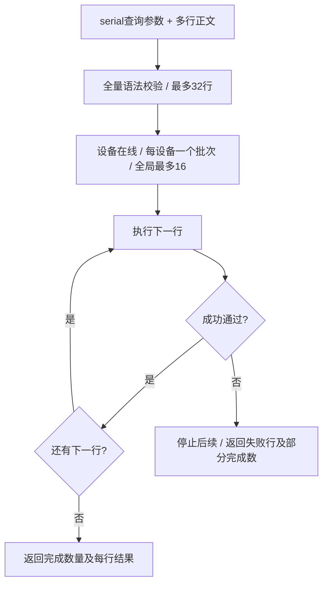

# 2026-11-13 自动化文本技能接口验证

## 范围与源码

实际运行源码：`/Users/liuzhuo/～/code/Farm`，分支 `lz/v2026.11.13-feature`；与最初工作目录 `/Users/liuzhuo/code/Farm` 不是同一份源码。本次没有修改后者，也没有提交或推送。保护现有未提交的设备标识名、离线展示、Companion 等改动。

- 新增 `GET /api/automation/devices`：纯文本，一行一台在线设备。
- 新增 `POST /api/automation/act?serial=<真实serial>`：正文每行一个操作，支持 tap/keyevent/sendkey/swipe/check/ocr/wait/sleep。
- observe 与日志增加显式 `format=text`，保留已有默认行为；`/fram.skill` 只引导文本调用，附完整单步、多步、输入、失败和 curl 示例。
- 原 `/api/devices` 实现与 OpenAPI 对象均与改动前快照逐字/结构比较一致；运行时继续返回数组 JSON。
- 四份技能与四份请求客户端迁移文本调用；旧已停用专用脚本保留。

## 自动化验证

- `go test ./internal/automation ./internal/apidocs ./internal/skillsmarket -count=1`：通过。
- 滑动修正后的 `go test ./internal/ws ./internal/automation -count=1`：通过（ws 6.133秒，automation 1.235秒）。
- 根包接口规范、技能页、自动化过滤与 WebApp 针对性测试：通过。
- `git diff --check`：通过。
- 四份实际请求客户端经本地 HTTP 夹具执行 24 个技能示例：通过；核对 query、文本原始字节、批次超时、错误保留与正文选项互斥，拒绝输入文本换行变成额外操作。
- 单测覆盖全语法预校验、32行上限、像素与旋转映射、分隔符、多键部分失败、等待命中/超时/来源故障/取消、同设备互斥/容量/收尾、Unicode 剪贴板消息及各点击模式下键盘通道。

## 本机浏览器与 Redmi 真机

设备为用户选择的 Redmi（`10.0.0.30:5555`），1080×2400，系统设置页。使用 lz-auto 的浏览器与 ADB 流程核对真实页面。

- 浏览器打开 `/fram.skill`，确认单步、多行、输入、失败与 curl 示例存在；可见内容无 Content-Type、application/json、Schema、MCP/Safety 或旧动作接口。
- 在线列表按设备逐行返回；缺 serial 的观察错误也为明确文本。
- `tap → sleep → wait → check → ocr`：5/5 完成；后置控件树确认进入 WLAN 页面。
- 不存在文字的 `check`：HTTP 409，完成 0/2，失败行 1；其后的 Home 未执行，后置页面仍为 WLAN。
- `keyevent back｜back,home`：按键 3/3 完成；后置控件树确认 `com.miui.home`。
- `keyevent home` 后接未知操作：HTTP 400，失败行 2，完成 0/2；首行 Home 未执行，后置仍为设置搜索输入框。
- `wait 1500 FARM_TEST_MISSING_20261113` 后接 Home：HTTP 408，失败行 1，完成 0/2，后续停止。
- 首次使用旧 TextEvent 发送中文出现静默丢字，因此新 sendkey 改为现有 SDK 剪贴板粘贴；修正后真机控件树明确显示 `input "Farm验证 A1" ... focused editable`，核对中文、空格和大小写实际进入输入框。

### 滑动验收发现

初次新入口 swipe 虽返回执行成功，但实际设置列表前后截图未移动。源码核对确认旧 SDK swipe 只有 down/终点 move/up 且未使用 DurationMS。本轮只为 `Source=automation.act` 且提供 DurationMS 的 SDK/HID 分支补充有时序的滑动，保留旧调用行为；约16ms发送一个线性中间点，取消/写失败用独立有界上下文释放本次触点，不重放整段手势。

最终真机 `swipe @540,2000 @540,900 300` + `sleep 500` 完成2/2；日志 requested_ms=300 / elapsed_ms=300。前后截图确认设置列表滚动：原先顶部大标题与搜索框消失，WLAN升至顶部，下方出现桌面、指纹人脸密码、安全、隐私保护等条目。最终以Home键退出设置，ADB核对前台为com.miui.home。

## 运行与限制

已构建新后端、备份原 App、替换本机桌面 App sidecar、重新签名并启动 1989 服务。旧 App 备份：`/tmp/farm-automation-contract-before-20261113/Farm-before-text-input.app`。

批次请求上下文为60秒，单动作15秒；既有 Hub 的会话初始化不能被上下文强制中断，可能延迟退出，但初始化返回后队列检查取消，不重放、不继续过期操作。

本次后置 ref 观察多次返回502；中间一次回退读取成功，随后两次因 Companion 恢复后的快照读取超时继续失败。日志明确显示既有 Companion/uiautomator 回退及恢复失败。未将此类来源故障吞成成功，也未据此声称长期稳定性已验证。截图/OCR可能比动作滞后，调用者应等待目标页面独有文字并后置观察。ADB/HID模式组合与旋转坐标做了单测，未做相应真机覆盖；长期/多设备压力未验证。
