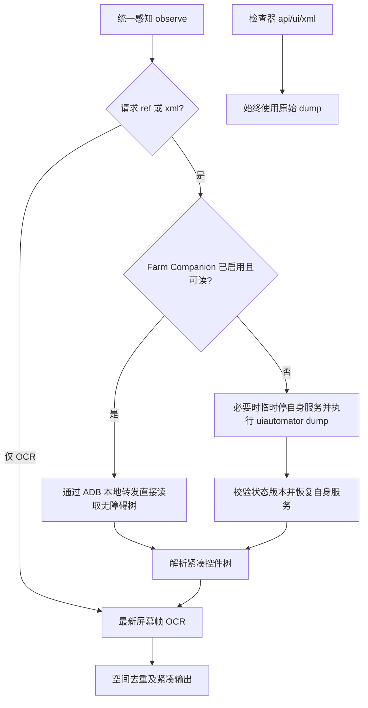

# UI XML、标识名与离线显示修复（2026-11-13）

实际运行工作副本：`/Users/liuzhuo/～/code/Farm`，分支 `lz/v2026.11.13-feature`。

## 根因与修复

日志中的 `serial=redmi` 被原样传给 ADB，实际错误是 `adb: device 'redmi' not found`，此前只返回 `exit status 1`。同一设备使用真实 serial `10.0.0.30:5555` 后 dump 成功。失败与性能是两个问题。

- 设备列表增加 `identifier`，按已保存的非空 alias、品牌、serial 明确生成。标识名通过现有 PATCH alias 接口持久保存，自动发现的设备也支持；界面与 MCP 使用同一个服务端标识名。
- MCP 支持真实 serial 和忽略大小写的标识名；serial 优先，重名按在线列表第一台。会话绑定真实 serial，改名不更换已绑定设备。找不到设备时返回当前在线标识名、serial、状态；`phone_devices` 可主动查询。
- 底栏“设备”卡增加默认关闭的“显示离线设备”开关，打开后显示保留的离线设备，不删除连接记录或关闭自动重连。离线设备不参与自动化选取及批量动作。
- `formats=["ocr"]` 不执行 dump、不解析 XML、不保留旧 ref；截图或 OCR 不可用则明确失败。默认 ref+ocr 保持。
- `phone_launch` 原先只有 Observe，现实际解析 Launcher、执行启动并验证前台包名；启动失败与启动后感知失败分别报告，避免误导重复执行。
- UI XML 失败保留 ADB/Android 输出与超时原因；新增采集阶段耗时日志。

## 数据源判断

初始调查时，ref 控件树由 `UIXMLProvider.FetchSnapshot` 的 uiautomator XML 解析生成，仓库没有独立 AccessibilityService 树通道，隐藏 XML 不会省掉 dump。用户随后确认增加独立 Companion 快通道，见下节。

[AOSP DumpCommand 源码](https://android.googlesource.com/platform/prebuilts/fullsdk/sources/android-29/+/refs/heads/main/com/android/commands/uiautomator/DumpCommand.java) 也表明 dump 包含等待 idle、读取 Accessibility 根节点与序列化；[Android AccessibilityNodeInfo 文档](https://developer.android.com/reference/android/view/accessibility/AccessibilityNodeInfo)说明树具有可编辑、选中、可点击及内容描述等属性。这些语义无法仅由文字 OCR 直接取得。

建议保留按需控件树：普通可见文字定位、连续看屏用 OCR；需要输入框、开关状态、无文字图标语义或 OCR 无法唯一定位时用 ref+ocr；原始 XML 用于检查器与调试。本轮后续已按用户要求增加独立无障碍树，命令行 dump 保留为回退和检查器的原始快照。

## 初始真机采样

设备 Redmi M2004J7AC，Android 12，ADB TCP `10.0.0.30:5555`，桌面页面，模型已热身，未添加 settle 等待。以下为一次顺序采样，不是统计分位数：

| 模式 | 整轮耗时 | 有效信息 |
|---|---:|---|
| ref | 3.596 秒 | 7 个树元素；XML 17,087 字节，XML采集 2.794 秒 |
| ocr | 0.969 秒 | 引擎成功，0 个文字框；不能据此断言足以替代树 |
| ref+ocr | 3.662 秒 | 7 个树元素，OCR 0 个补充文字框 |

另一次直接 shell dump 为 3.256 秒；一次采集观察到 XML 采集 6.427 秒，说明延迟有波动。没有将默认模式改为 OCR，也没有靠忽略 dump 错误恢复假成功。

## 验证记录

- 单元测试覆盖 dump 真实错误/超时、OCR-only 跳过 dump 与失败不缓存、标识名及自动发现设备持久化、重名/大小写/serial 优先、离线与未知设备、会话绑定、应用启动前台验证及后置感知失败。
- 全量 Go 测试首次出现 OCR 进程启动夹具 HTTP 500，单独重跑该测试通过；最终结果见本轮交付。
- 前端 TypeScript 与生产构建通过。

## 后续确认：参考 Pinky 增加 Companion

用户确认保留 dump 后，进一步要求参考 Pinky。核实本地 Pinky `ff473e2`：`internal/driver/android/observe.go:66` 优先 `observeCompanion`，失败停用自身后 `observeDump`；设备端 `TreeDumper.kt` 直接读取无障碍窗口，非每轮执行命令行 dump。Pinky README 的约70ms为上游自述，本轮未把它当成 Redmi 实测。

本轮据此独立实现 `packages/android-companion`（未复制 Pinky 源码），并新增 `internal/companion` 宿主端。初始调查时 Farm 不存在独立树通道，本轮新增后已具备以下路径：

设备/编号右键“设备助手”显式安装、启用和停用；安装不自动授权。当前启用后持续可用，尚未实现 Pinky 的按任务启停 lease。服务仅有只读 snapshot 和独立 ping 协议，没有网络监听、动作注入或通知读取；主机通过已授权 ADB 转发，Unix peer 限 shell/root/自身，密码文字不输出。

默认 ref+ocr 保持，快通道失败继续 dump。临时停用/恢复只处理自身，无障碍列表与 master 开关复读验证，排队的用户启停或外部无障碍服务列表变化会阻止旧恢复写回。截图和 OCR 请求仍保持原有来源。

## 联合压力验收暴露的问题与修正

另一会话“重构自动化操作接口”在 Redmi 上测试输入、滑动等行为时，于 15:15–15:18 多次触发 Companion 快照超时。日志表明 dump 本身均成功，但其中三轮因恢复阶段超时被改为观察 502；因此初轮成功采样不能代表稳定性通过。

已定位两个预算冲突：宿主快路径 1.5 秒包含设置读取、forward、设备采集与传输，而 Android 允许采集本身用到 2 秒；恢复只有 3 秒，却串行恢复/复读设置并再次执行 snapshot。同一棵树的读取失败被误用来判定服务恢复失败。

修正方向：快路径预算 4 秒、恢复预算 8 秒；协议升级 v2，新增独立 ping/pong，直接由连接线程响应，不进入树采集队列，也不读取窗口。恢复配置仍严格复读，真实恢复失败继续报错；服务存活使用独立心跳确认，当前页面树由 observe 采集。`ready` 表示配置已启用且通信可达，不承诺当前窗口必有可用树。旧开发 APK 明确显示需要更新，安装/更新仍由用户显式触发，不猜测兼容。

APK 更新至 versionCode=2/versionName=1.0.1，包名和签名保持，协议 v1 明确拒绝。Android 构建验证包括树采集线程和队列被占满时仍能 ping，原 XML Unicode 与字节限制测试保留。

## 本轮范围的额外边界

只读审查同时发现既有 `internal/mcp/server.go` 的 `phone_tap(ref=...)` 分支仍将坐标设为屏幕中心，尚未按 ref 解析。本轮未使用该分支进行真机操作，也未修改此既有动作逻辑；控件树采集通过不代表所有 MCP 动作已经完整实现。另一会话的新坐标动作接口属于独立改动，予以保留。

## 最终验收（协议 v2）

- 本地运行版已更新，Redmi `10.0.0.30:5555` 已通过“设备助手”更新到 `1.0.1`（code 2）；包名、签名不变。实际状态为 installed/enabled/ready=true，update_available=false，ready由pong确认。
- MCP 使用小写标识名 `redmi` 实际启动系统设置成功，返回真实 Settings 控件树，不再将名称原样交给ADB，也不将后置感知失败误报为启动失败。
- 连续20轮设置页观察（16轮ref、4轮ref+ocr）全部200，全部source=companion，没有502；整轮中位1.423秒、最大1.819秒，树采集中位0.6095秒。该样本不是长期稳定性或跨机型保证。
- 显式停用后仍可正常观察，source=uiautomator，34个控件，整轮4.556秒。重新启用后已核实独立心跳与界面“已启用”。
- 锁屏时snapshot失败后实际回退dump成功200；锁屏期间ping仍ready=true，未二次读取坏树判断恢复；原服务列表保留，唤醒后正常就绪。
- 标识名实际保存和恢复默认值通过；模拟服务端保存失败时保留错误和原名称。离线开关打开后主卡片及编号均显示离线设备，关闭后均隐藏，未删除记录。
- 无残留farm_companion转发，无残留本轮farm-ui临时XML；既有scrcpy转发保留。
- 全量 `go test ./...`、Companion race、前端生产构建、Android纯Java测试与APK签名/版本/权限自检通过。真机仅验证Redmi Android12，未做跨机型和长时间负载测试。
- 本轮代码未提交、未推送；另一会话的统一动作、文档和手势改动均保留，未顺带清理。

本机桌面启动脚本的窗口就绪标记未能确认成功；已使用当前源码重新构建Go sidecar，保留现有GUI，重新签名并通过实际GUI/HTTP/设备结果验证运行版。验证不以该脚本退出码作为成功依据。
