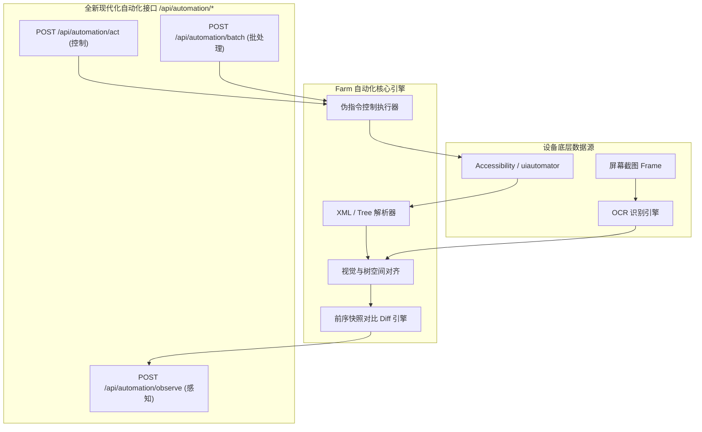

# v2026.11.12-feature 设计规范：现代自动化控制套件与紧凑感知接口

## 1. 架构总览与设计哲学

传统移动端自动化接口通常针对程序化脚本设计，直接输出结构繁杂的完整 JSON 或未经加工的 Accessibility XML。这种模式在接入大语言模型（LLM / AI Agent）时暴露出一系列致命痛点：
1. **Token 爆炸**：单屏 JSON/XML 常占 10k~30k tokens，数轮操作后即触发上下文瓶颈。
2. **运算幻觉**：要求模型根据 `[left, top, right, bottom]` 计算中心点击点，模型极易产生四则运算幻觉导致点偏。
3. **多模态割裂**：UI 树与 OCR 分离，模型需权衡调用哪一个，难以统一空间感知。

本版本确立**以 AI Agent 为核心**的全新设计准则：
- **行协议（Line-oriented DSL）**：一元素一行，消除语法嵌套噪音。
- **中心坐标直供**：后端预计算绝对中心点 `@X,Y`，支持全局引索 `[ref]` 与直接坐标互补。
- **感知融合（Hybrid Perception）**：Accessibility 树与 OCR 视觉在统一空间坐标下并流输出。
- **增量感知（Diff Streaming）**：连续动作优先输出 Diff 增量，降低 80% 以上 Token 消耗。



---

## 2. 关于 XMLDump 必要性的专门判定

针对“感知接口是否需要支持 xmldump，其是否有必要”的评估结论如下：

### 核心结论
- **作为中间解析层（Data Extractor）：绝对必要**。
  没有底层 Accessibility Node 信息的提取，纯靠 OCR 无法获取控件的固有属性（如：是否是可输入框 `editable`、是否是密码框 `password`、是否是选中开关 `checked`、是否处于禁用态 `disabled` 等）。
- **作为对外返回给 AI Agent 的数据形式：绝对不必要，甚至有严重害处**。
  - **严重惩罚 Token**：XML 标签嵌套、冗长命名空间（`android.widget.FrameLayout` 等）不仅消耗巨额 Token，还会让大模型注意力机制产生 Lost in the Middle 效应。
  - **延迟与脆弱**：Android 系统的原生 `uiautomator dump` 每次调用耗时在 800ms ~ 2.5s，若每次感知都向外暴露并由外部处理，会导致 Agent 极度迟钝。
- **架构落地方案**：
  1. 感知接口默认返回**提取扁平化后的紧凑行协议**（`ref` + `ocr`）。
  2. 接口参数支持 `formats` 数组：如 `formats: ["ref", "ocr"]`（默认推荐）。
  3. 仅保留 `formats: ["xml"]` 作为**开发者低级调试（Debug）或传统爬虫脚本的兼容选项**，在 AI 自动化文档与系统 Prompt 中将其隐蔽或置为仅调试用途。

---

## 3. 感知接口规范 (`POST /api/automation/observe`)

### 3.1 请求参数
```json
{
  "serial": "device-serial-number",
  "formats": ["ref", "ocr"],       // 可选: "ref", "ocr", "xml"。默认 ["ref", "ocr"]
  "diff": true,                     // 是否优先返回增量差异，默认 true
  "settle_ms": 300                  // 等待画面静止延时 (毫秒)
}
```

### 3.2 紧凑文本返回规范（AI 读取格式）
返回正文为纯文本（UTF-8），结构如下：

1. **第一行：元数据信息行**
   ```text
   screen 1080x2400 · app: Settings (com.android.settings) · portrait · keyboard hidden · focus [3]
   ```
2. **事件通告行（若有）**
   ```text
   toast: "已保存到相册"
   notification: WeChat · "收到一条新消息"
   ```
3. **原生组件行（`ref` 模式）**
   ```text
   [{ref}] {role} "{label}" @{centerX},{centerY} {states...}
   ```
   - 示例：
     ```text
     [1] button "返回" @60,120
     [2] text "设置" @540,120
     [3] input "搜索设置" @540,240 focused editable
     [4] switch "WLAN" @980,420 checked
     ```
4. **OCR 补充行（`ocr` 模式）**
   针对无独立 Accessibility 节点的文字（如图片文字、Canvas 渲染文字等）：
   ```text
   ocr "{text}" @{centerX},{centerY}
   ```
   - 示例：
     ```text
     ocr "已连接到 5G_WiFi" @320,480
     ocr "立即升级" @850,920
     ```

### 3.3 增量 Diff 输出格式
当 `diff: true` 且满足对比条件时，返回差异标记：
- `+ [ref] ...`：新增元素（如弹窗浮层出现）
- `- [ref] ...`：消失元素
- `~ [ref] ...`：属性变化元素（如开关状态改变）
- `+ ocr "..." @x,y`：新增识别文字
- 若切换前台应用、旋转屏幕或变更行数超过全屏，自动降级为返回全量 Screen 文本。

---

## 4. 控制接口规范 (`POST /api/automation/act`)

### 4.1 伪控制语言语法支持
接口接收单个指令或指令字符串：

| 指令语法 | 说明 | 示例 |
| :--- | :--- | :--- |
| `tap(ref?, x?, y?, long_press?)` | 优先通过 `ref` 点击；纯视觉使用 `x,y` | `tap(ref=4)` 或 `tap(x=850, y=920)` |
| `type(text, ref?, submit?, append?)` | 向指定 `ref` 或当前焦点输入文本 | `type('hello', ref=3, submit=true)` |
| `swipe(direction, ref?)` | 上下左右滑动，支持在指定元素内滑动 | `swipe('up')` 或 `swipe('down', ref=5)` |
| `drag(from_x, from_y, to_x, to_y)` | 绝对坐标拖拽 | `drag(300, 500, 300, 1200)` |
| `key(name)` | 硬件按键模拟 | `key('back')`, `key('home')` |
| `wait(ms)` | 延时等待 | `wait(500)` |

### 4.2 请求格式兼容
既支持伪代码字符串，也支持结构化 JSON：
```json
// 伪语言格式（极力推荐 AI Agent 使用，输出极短）
{
  "serial": "device-serial",
  "action": "tap(ref=4)"
}

// 结构化格式
{
  "serial": "device-serial",
  "action": {
    "tool": "tap",
    "ref": 4
  }
}
```

### 4.3 批量操作接口 (`POST /api/automation/batch`)
允许一次下发流水线操作：
```json
{
  "serial": "device-serial",
  "actions": [
    "tap(ref=3)",
    "type('WiFi 密码', append=false)",
    "tap(ref=6)"
  ]
}
```
执行完毕后直接返回最后一步动作后的 Screen 或 Diff 文本，节省网络轮询往返。

---

## 5. 自动化文档收敛规划 (`configs/automation-apis.json`)

原 `configs/automation-apis.json` 包含 68 个端点，将历史冗余接口收敛，仅保留现代化自动化核心套件：
- `POST /api/automation/observe`（统一感知，支持 ocr/ref/xml 与 diff）
- `POST /api/automation/act`（统一控制，支持伪语言）
- `POST /api/automation/batch`（批量动作执行）
- `GET /api/automation/devices`（可用设备列表与基本状态）
- `GET /api/automation/device/{serial}`（单设备属性与屏幕规格）

所有历史接口（如 `/api/v1/vision/actions/*`、`/api/v1/actions/*`）在底层保留兼容转发，但在 `/api-docs-automation.html` 中下线隐藏，使 Agent 能够获得 100% 聚焦、高纯度的自动化开发指南。
